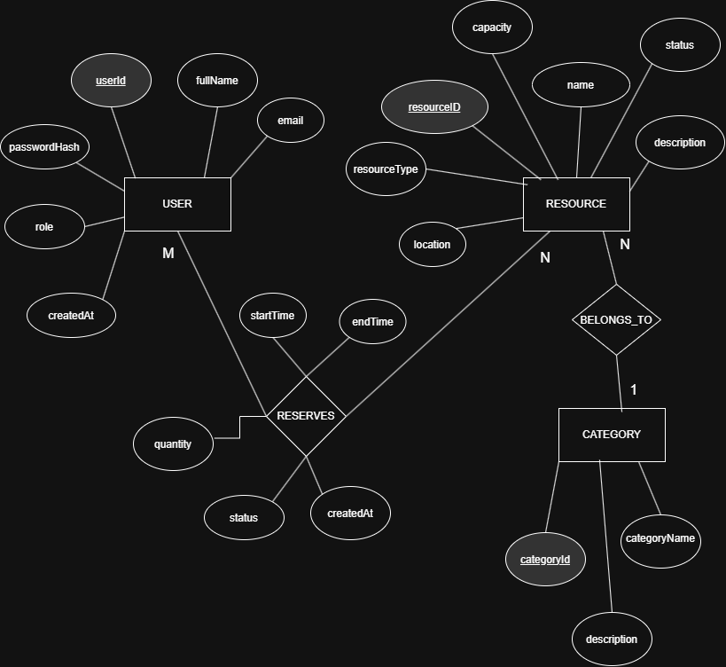

## ER Diagram

The Entity-Relationship (ER) diagram represents the structure of the ReserveHub Resource Reservation Management System. It illustrates the main entities, their attributes, and the relationships between them.

### Entities and Attributes

- **User:** Stores user information, including user ID, full name, email, password hash, role, and creation date.
- **Resource:** Stores resource details, including resource ID, name, description, type, location, capacity, and status.
- **Category:** Stores resource category information, including category ID, category name, and description.

### Relationships

- **Reserves:** Represents the relationship between users and resources, including reservation start time, end time, status, and creation date.
- **Belongs To:** Represents the relationship between resources and categories, where a resource belongs to one category and a category can contain multiple resources.

### ER Diagram

